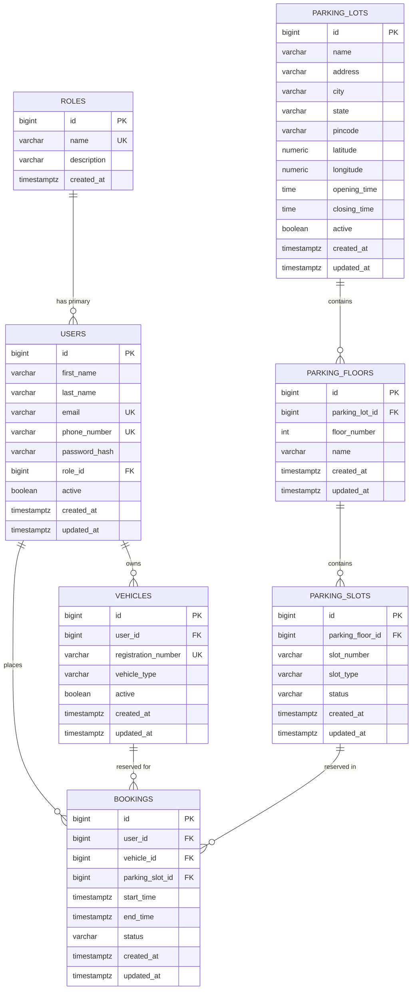

# SmartPark India — Database Design & Schema Specification

**Phase 1: Domain Model & Database Foundation**

This document details the relational data model for SmartPark India, outlining tables, relationships, integrity constraints, indexing strategies, and architectural design assumptions.

---

## 1. Entity-Relationship Overview

---

## 2. Table Specifications

### 2.1 `roles`
Lookup table defining authorization roles in the platform.

| Column | Type | Constraints | Description |
|---|---|---|---|
| `id` | `BIGINT` | `PK, GENERATED ALWAYS AS IDENTITY` | Primary key |
| `name` | `VARCHAR(50)` | `NOT NULL, UNIQUE` | Role identifier (`DRIVER`, `OPERATOR`, `ADMIN`) |
| `description` | `VARCHAR(255)` | `NULLABLE` | Human-readable role description |
| `created_at` | `TIMESTAMPTZ` | `NOT NULL, DEFAULT NOW()` | Record creation timestamp |

### 2.2 `users`
Represents registered platform users (drivers, operators, admins).

| Column | Type | Constraints | Description |
|---|---|---|---|
| `id` | `BIGINT` | `PK, GENERATED ALWAYS AS IDENTITY` | Primary key |
| `first_name` | `VARCHAR(100)` | `NOT NULL` | First name |
| `last_name` | `VARCHAR(100)` | `NOT NULL` | Last name |
| `email` | `VARCHAR(255)` | `NOT NULL, UNIQUE` | Unique email (login handle) |
| `phone_number` | `VARCHAR(20)` | `UNIQUE` | Unique phone number |
| `password_hash` | `VARCHAR(255)` | `NOT NULL` | Bcrypt/Argon2 password hash (no plaintext) |
| `role_id` | `BIGINT` | `NOT NULL, FK -> roles(id)` | User's assigned role |
| `active` | `BOOLEAN` | `NOT NULL, DEFAULT TRUE` | Account active flag |
| `created_at` | `TIMESTAMPTZ` | `NOT NULL, DEFAULT NOW()` | Record creation timestamp |
| `updated_at` | `TIMESTAMPTZ` | `NOT NULL, DEFAULT NOW()` | Last update timestamp |

### 2.3 `vehicles`
Represents vehicles registered by users to reserve parking.

| Column | Type | Constraints | Description |
|---|---|---|---|
| `id` | `BIGINT` | `PK, GENERATED ALWAYS AS IDENTITY` | Primary key |
| `user_id` | `BIGINT` | `NOT NULL, FK -> users(id)` | Owning user |
| `registration_number` | `VARCHAR(20)` | `NOT NULL, UNIQUE` | Indian registration plate (e.g. MH12AB1234) |
| `vehicle_type` | `VARCHAR(50)` | `NOT NULL, CHECK (CAR, MOTORCYCLE, SUV, OTHER)` | Vehicle classification |
| `active` | `BOOLEAN` | `NOT NULL, DEFAULT TRUE` | Active vehicle status flag |
| `created_at` | `TIMESTAMPTZ` | `NOT NULL, DEFAULT NOW()` | Record creation timestamp |
| `updated_at` | `TIMESTAMPTZ` | `NOT NULL, DEFAULT NOW()` | Last update timestamp |

### 2.4 `parking_lots`
Represents a physical parking garage or parking lot facility.

| Column | Type | Constraints | Description |
|---|---|---|---|
| `id` | `BIGINT` | `PK, GENERATED ALWAYS AS IDENTITY` | Primary key |
| `name` | `VARCHAR(150)` | `NOT NULL` | Parking facility name |
| `address` | `VARCHAR(255)` | `NOT NULL` | Street address |
| `city` | `VARCHAR(100)` | `NOT NULL` | City (e.g. Bengaluru, Mumbai, Delhi) |
| `state` | `VARCHAR(100)` | `NOT NULL` | Indian State / UT |
| `pincode` | `VARCHAR(10)` | `NOT NULL` | 6-digit Indian PIN code |
| `latitude` | `NUMERIC(10, 7)` | `NOT NULL, CHECK (-90 <= lat <= 90)` | WGS84 Latitude coordinate |
| `longitude` | `NUMERIC(10, 7)` | `NOT NULL, CHECK (-180 <= lon <= 180)` | WGS84 Longitude coordinate |
| `opening_time` | `TIME` | `NULLABLE` | Daily opening time |
| `closing_time` | `TIME` | `NULLABLE` | Daily closing time |
| `active` | `BOOLEAN` | `NOT NULL, DEFAULT TRUE` | Facility active flag |
| `created_at` | `TIMESTAMPTZ` | `NOT NULL, DEFAULT NOW()` | Record creation timestamp |
| `updated_at` | `TIMESTAMPTZ` | `NOT NULL, DEFAULT NOW()` | Last update timestamp |

### 2.5 `parking_floors`
Represents a designated floor or level within a parking lot facility.

| Column | Type | Constraints | Description |
|---|---|---|---|
| `id` | `BIGINT` | `PK, GENERATED ALWAYS AS IDENTITY` | Primary key |
| `parking_lot_id` | `BIGINT` | `NOT NULL, FK -> parking_lots(id)` | Parent parking lot |
| `floor_number` | `INT` | `NOT NULL` | Floor index (-2 for B2, 0 for Ground, 1 for L1) |
| `name` | `VARCHAR(100)` | `NOT NULL` | Descriptive name (e.g. "Basement 1") |
| `created_at` | `TIMESTAMPTZ` | `NOT NULL, DEFAULT NOW()` | Record creation timestamp |
| `updated_at` | `TIMESTAMPTZ` | `NOT NULL, DEFAULT NOW()` | Last update timestamp |

### 2.6 `parking_slots`
Represents individual parking spots/bays located on a floor.

| Column | Type | Constraints | Description |
|---|---|---|---|
| `id` | `BIGINT` | `PK, GENERATED ALWAYS AS IDENTITY` | Primary key |
| `parking_floor_id` | `BIGINT` | `NOT NULL, FK -> parking_floors(id)` | Parent parking floor |
| `slot_number` | `VARCHAR(50)` | `NOT NULL` | Slot identifier (e.g. "A-12", "EV-01") |
| `slot_type` | `VARCHAR(50)` | `NOT NULL, CHECK (REGULAR, DISABLED, EV)` | Slot feature type |
| `status` | `VARCHAR(50)` | `NOT NULL, DEFAULT 'AVAILABLE', CHECK (AVAILABLE, OUT_OF_SERVICE)` | Operational condition |
| `created_at` | `TIMESTAMPTZ` | `NOT NULL, DEFAULT NOW()` | Record creation timestamp |
| `updated_at` | `TIMESTAMPTZ` | `NOT NULL, DEFAULT NOW()` | Last update timestamp |

### 2.7 `bookings`
Represents a driver's reservation of a specific parking slot for a vehicle over a designated time span.

| Column | Type | Constraints | Description |
|---|---|---|---|
| `id` | `BIGINT` | `PK, GENERATED ALWAYS AS IDENTITY` | Primary key |
| `user_id` | `BIGINT` | `NOT NULL, FK -> users(id)` | Reserving user |
| `vehicle_id` | `BIGINT` | `NOT NULL, FK -> vehicles(id)` | Associated vehicle |
| `parking_slot_id` | `BIGINT` | `NOT NULL, FK -> parking_slots(id)` | Targeted slot |
| `start_time` | `TIMESTAMPTZ` | `NOT NULL` | Slot reservation start timestamp |
| `end_time` | `TIMESTAMPTZ` | `NOT NULL` | Slot reservation end timestamp |
| `status` | `VARCHAR(50)` | `NOT NULL, CHECK (PENDING, CONFIRMED, CANCELLED, COMPLETED, EXPIRED)` | Reservation lifecycle state |
| `created_at` | `TIMESTAMPTZ` | `NOT NULL, DEFAULT NOW()` | Record creation timestamp |
| `updated_at` | `TIMESTAMPTZ` | `NOT NULL, DEFAULT NOW()` | Last update timestamp |

---

## 3. Important Constraints & Rationale

1. **`uq_roles_name` on `roles(name)`**: Prevents accidental duplication of role categories.
2. **`uq_users_email` on `users(email)`**: Guarantees unique user authentication identity across the platform.
3. **`uq_users_phone_number` on `users(phone_number)`**: Prevents one phone number being claimed across multiple user accounts.
4. **`uq_vehicles_registration_number` on `vehicles(registration_number)`**: Standard Indian vehicle registration numbers are legally unique per vehicle.
5. **`uq_parking_floors_lot_number` on `parking_floors(parking_lot_id, floor_number)`**: Ensures each floor number in a lot is unique (e.g. cannot have two Level 1s in the same lot).
6. **`uq_parking_slots_floor_slot` on `parking_slots(parking_floor_id, slot_number)`**: Prevents slot name collision within the same floor.
7. **`chk_booking_time_validity` on `bookings(end_time > start_time)`**: Fundamental integrity rule guaranteeing reservations have a positive non-zero duration.
8. **`chk_latitude_range` & `chk_longitude_range`**: Rejects invalid geographic coordinates at the database layer.
9. **`ON DELETE RESTRICT` on Foreign Keys**: Prevents accidental deletion of users or slots when historical bookings exist, maintaining referential and audit integrity.

---

## 4. Indexing Strategy

| Index Name | Table | Columns | Query Optimization Reason |
|---|---|---|---|
| `idx_users_email` | `users` | `email` | Accelerates user login and authentication lookup by email. |
| `idx_users_role_id` | `users` | `role_id` | Speeds up operator/admin listing and role-based filtering. |
| `idx_vehicles_user_id` | `vehicles` | `user_id` | Speeds up loading all vehicles belonging to the logged-in driver. |
| `idx_vehicles_reg_number` | `vehicles` | `registration_number` | Quick lookup during ANPR (automatic number plate recognition) / entry scans. |
| `idx_parking_lots_city` | `parking_lots` | `city` | Critical for driver searches querying lots available in a specific city. |
| `idx_parking_floors_lot_id` | `parking_floors` | `parking_lot_id` | Joins lot -> floors quickly when rendering lot layout. |
| `idx_parking_slots_floor_id` | `parking_slots` | `parking_floor_id` | Joins floor -> slots efficiently when displaying floor availability. |
| `idx_bookings_user_id` | `bookings` | `user_id` | Fetches a driver's booking history and active passes. |
| `idx_bookings_parking_slot_id` | `bookings` | `parking_slot_id` | Quickly checks existing bookings for a target slot. |
| `idx_bookings_vehicle_id` | `bookings` | `vehicle_id` | Allows querying if a vehicle already has an active reservation. |
| `idx_bookings_slot_times` | `bookings` | `(parking_slot_id, start_time, end_time)` | **Core booking optimization**: Enables high-performance queries that verify whether a given slot has any overlapping bookings within a desired window `[start_time, end_time]`. |

---

## 5. Design Assumptions

1. **Temporal Data (`TIMESTAMPTZ`):** All timestamps are stored with time zone information in UTC. This is essential for standardizing time handling across multiple client devices and geographic zones.
2. **Surrogate Keys (`BIGINT IDENTITY`):** 64-bit integer IDs ensure high throughput and compact indexing without premature UUID storage overhead.
3. **No Soft Deletes yet:** We use an `active` boolean flag on `users`, `vehicles`, and `parking_lots` for simple active/inactive filtering without introducing complex soft-delete frameworks prematurely.
4. **Decoupled Concurrency:** The schema is prepared for concurrency checks via the composite `(parking_slot_id, start_time, end_time)` index and temporal check constraints, while the actual locking and double-booking prevention will be implemented deliberately in later dedicated phases.
